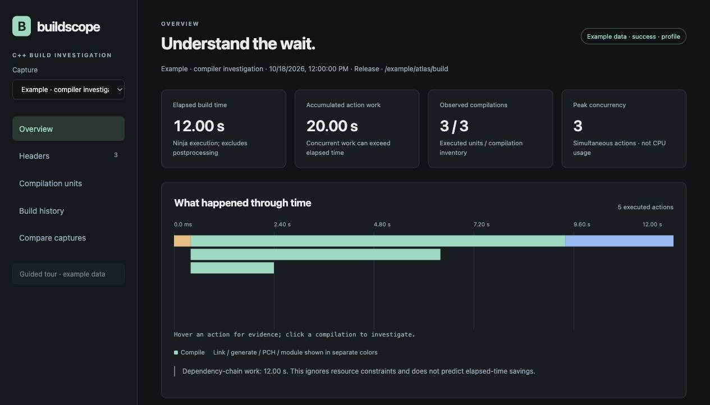
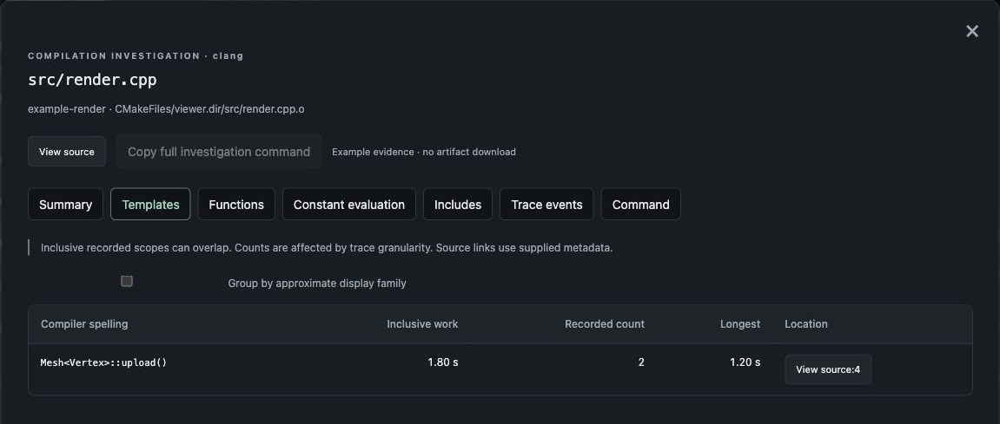
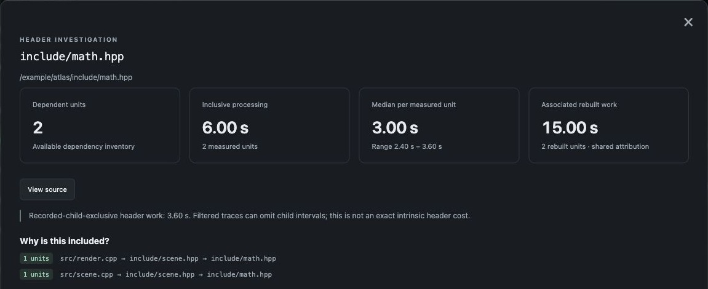

# Buildscope

Buildscope explains C++ build time using CMake, Ninja, Clang, and GCC evidence.
It is a Rust command-line application with an embedded local browser report for
Linux and macOS. No frontend toolchain or external database server is needed.

Record ordinary builds to understand elapsed time, dependencies, and rebuild
history. Use a separate compiler profile to investigate expensive headers,
templates, compile-time evaluation, and code generation.

*See elapsed time, accumulated work, and concurrent actions at a glance.*
Screenshots use the guided tour's synthetic example data.

## Quick start

Requirements: a current Rust toolchain, CMake, Ninja, and a C++ compiler on PATH.
Start from an existing configured single-config Ninja build.

~~~sh
cargo build --release --locked

# Observe an ordinary build without adding compiler profiling flags.
target/release/buildscope record --build-dir /path/to/build --target app
target/release/buildscope report latest

# Collect new compiler measurements in an isolated, reusable profile tree.
target/release/buildscope profile --build-dir /path/to/build --target app
target/release/buildscope report latest
~~~

The default capture store is .buildscope in the current directory. Pass
--store /path/to/captures, or set BUILDSCOPE_STORE, to use another location.
Run IDs accept unique prefixes; latest selects the newest capture.

Captures save the local Git branch, full HEAD commit ID, and working-tree dirty
state from the configured CMake source directory before compilation. The report,
`list`, `inspect`, and comparisons show the saved revision; `inspect --json`
includes the full metadata. The report can copy the full commit ID. Detached HEAD,
branches without commits, non-Git projects, unavailable Git, and older captures
without metadata have explicit states. Git discovery failures do not fail a build.

Public compiler launchers save Git state before each compiler invocation. `collect`
uses those saved observations even if you have since switched branches. Batches
with differing branches, commits, or discovery outcomes show a mixed Git state;
individual snapshots remain in `observations/*.json` inside the capture and its
exported archive. Any dirty observation flags uncommitted changes; a batch is
clean only when every observation was known to be clean. Older launcher spool
entries remain “not recorded.”

Dirty state includes staged, unstaged, conflicted, and untracked files across the
containing repository, respecting ignore rules, including submodule changes.
Ignore build outputs and Buildscope's stores/spools in Git to avoid counting them
as untracked work. Git status scans run outside measured compiler/build duration;
launcher mode performs a scan per invocation, which can add overhead in large
repositories. HEAD and a dirty flag are provenance, not an exact source snapshot:
source edits during compilation are still possible. Git metadata remains separate
from project/configuration identity, and export/import preserves recorded values.

Buildscope is a standalone repository. Run these commands from its root directory.

## Guided UI tour

Choose **Guided tour · example data** in the report sidebar for an interactive
walkthrough of the overview, timeline, findings, headers, compilation details,
trace scopes, history, and comparisons. You can try searches, source previews,
and detail tabs during the tour. Back/Next move through the steps; Finish, Exit,
or Escape returns to your original capture and filters. Arrow keys navigate
while the tour controls have focus.

To learn the UI before recording a build:

~~~sh
target/release/buildscope report --tour
~~~

The tour uses clearly marked synthetic captures held in browser memory. Its
ordinary before/after recordings are separate from the example compiler profile.
It runs no build, saves no example captures, and reads no example source paths.
After exiting with an empty store, the report shows first-capture instructions.

## Use a compiler launcher during normal builds

Install the executable on PATH (`cargo install --path . --locked`), or use
its absolute release-binary path. Set both launcher variables before creating
CMake targets:

~~~cmake
find_program(BUILDSCOPE_EXECUTABLE NAMES buildscope REQUIRED)
set(CMAKE_CXX_COMPILER_LAUNCHER
    "${BUILDSCOPE_EXECUTABLE};launch;--build-dir;${CMAKE_BINARY_DIR};--")
set(CMAKE_C_COMPILER_LAUNCHER "${CMAKE_CXX_COMPILER_LAUNCHER}")
~~~

Alternatively, configure an existing project from the command line:

~~~sh
cmake -S . -B build -G Ninja \
  '-DCMAKE_CXX_COMPILER_LAUNCHER=/absolute/path/buildscope;launch;--' \
  '-DCMAKE_C_COMPILER_LAUNCHER=/absolute/path/buildscope;launch;--'
cmake --build build --parallel
buildscope collect --build-dir build --label development
buildscope report latest
~~~

The launcher discovers the root Ninja directory from its working-directory
ancestors; `--build-dir` makes the root explicit for unusual invocation layouts.
Use `;launch;--detail;full;--build-dir;...;--` to opt into zero-threshold Clang
traces. Standard detail is the default because full traces add significant time
and disk use. GCC supplies aggregate timers in either mode.

Each compiler writes independent artifacts under `build/.buildscope-launcher`.
No shared database or Ninja queries run in compiler processes. Compiler arguments,
response-file contents, diagnostics, exit codes, include relationships, and
profiling artifacts are retained. Public GCC launching preserves native text
diagnostics. Compiler configuration checks pass through without capture; the
build outputs remain in the original build tree and existing cache environment
settings are preserved. Install Buildscope directly before the actual Clang/GCC
executable; arbitrary compiler-cache/launcher chains are forwarded without
compiler detail when their executable cannot be identified.

Run `collect` after each build, including failed builds, and before reconfiguring
the project. It does not run a build or compile anything. It consumes completed
invocations, indexes a capture of kind `launcher`, and removes their spool files
after the capture and receipts have committed. Collection is locked per build;
parallel compiler writers never need that lock. Active or abruptly killed
invocations without a completion marker remain in the spool. Collection retries
do not duplicate already committed invocations. `--store` selects the destination
for collection and reporting, not the per-build spool location.

A launcher cannot determine complete build boundaries, requested targets, link
status, native rebuild explanations, or no-op build timing. One collection groups
all pending invocations, even if they came from several builds. Its observed
compiler span excludes links and generators; success describes compiler exits
only. No-op builds create no launcher capture. Source fingerprints are collected
after each compiler completes, and the current dependency inventory is read at
collection time. Changed contributors are observations between compatible
collections, not proof of an exclusive rebuild cause. Repeated invocations of one
unit retain all raw evidence; named detail uses the latest decoded attempt.

Use `buildscope record` when you need the complete Ninja timeline and native
rebuild explanations; use a managed `profile` when you want isolated, fresh
compiler measurements. Launcher instrumentation adds overhead to normal builds.
If a public launcher is configured, `record` observes that existing instrumentation
and leaves its compiler detail in the spool for separate collection.

## What each compiler supplies

| Measurement | Clang | GCC |
| --- | --- | --- |
| Executed action durations and dependency chain | Ninja recording | Ninja recording |
| Header reach across compilation units | Ninja dependencies | Ninja dependencies |
| Observed include chains | -H | -H |
| Individual textual-header processing time | Time trace | Unavailable |
| Aggregate compiler activity | Native trace totals | Native timing report |
| Named template instantiation timings | Recorded events | Unavailable |
| Named function backend timings | Recorded events | Unavailable |
| Constant-expression evaluation | Recorded events, varying metadata | Aggregate timer |
| Preprocessed output size | Separate preprocessing probe | Separate preprocessing probe |
| Rebuild causes and frequency | Recorded history | Recorded history |

Clang uses -ftime-trace. Drivers such as Clang 14 that cannot choose a trace
filename use their output-derived JSON sidecar, which Buildscope retains in the
capture while preserving any existing sidecar. Standard detail retains the default
500 microsecond threshold. Full detail uses a zero threshold and enables verbose
metadata when the executable advertises it.

GCC uses -ftime-report and -ftime-report-details. If a capability probe confirms
SARIF support, Buildscope reads the structured timing report from SARIF;
otherwise it parses the native text report. It preserves the original report
because timer names and representations differ across compiler versions.

The real-build tests exercise upstream Clang 20.1.8 and GCC 15.1.0 on the
development machine. Older and vendor-specific formats are covered by decoder
fixtures and capability detection, rather than an assumption of full parity.
The CI workflow exercises Linux and macOS; see [CI coverage](#ci-coverage) for
the versioned compiler and Ninja combinations.

## Investigate one compilation unit

~~~sh
target/release/buildscope inspect latest
target/release/buildscope profile --build-dir /path/to/build \
  --unit UNIT_ID --detail full
target/release/buildscope report latest
~~~

A unit ID identifies a source/output pair. A source compiled into two targets has
two unit IDs. An unambiguous ID prefix or exact portable source key also works.
The report can copy a focused investigation command.

Full detail also runs a separate preprocessing probe after the measured Ninja
execution. --preprocess enables that probe with standard profiling detail.
Preprocessed bytes/lines describe input volume; they are not token counts or
proof of parsing complexity.

The unit report has summary, templates, functions, constant evaluation, includes,
trace events, and original-command views.

*Inspect template instantiations and follow compiler-supplied source locations.*

Events can be searched, filtered by activity, ordered by duration or time, and
paged through the SQLite index.
Selecting a scope opens its immediate recorded children and containing scope.

Approximate template-family grouping is a display operation. Exact compiler
spellings remain available, and repeated-specialization findings match exact
spellings only. Symbol timings are inclusive and can overlap.

Definition/source links use metadata the compiler actually supplies. A trace
does not guarantee a triggering-use location or a complete semantic
template-instantiation dependency graph.

## Global compiler work

Open **Compiler work** in the report sidebar to rank templates, functions, and
constant evaluations across all translation units in the selected capture.
Each row sums recorded inclusive scope durations and shows distinct contributing
source/output pairs, recorded scope count, and longest scope. Target, compiler,
activity, and spelling/source-path filters apply before aggregation.
The total matching inclusive work above the results covers every matching row,
including other pages. Sorting and approximate family grouping preserve this
work total. An empty search result shows zero when named trace evidence exists;
a selection without named trace evidence shows **Unavailable**.

Select a row for its paginated per-unit contributions, then open the existing
unit investigation or inspect its matching recorded scopes and their containment.
Approximate template families retain an exact-spelling and source-variant
breakdown. Functions separate optimization from code generation. Unnamed
constant evaluations remain visible under their native activity.

Compiler identities, activities, and exact source-location variants remain
separate. GCC native aggregate timers appear separately from named Clang scopes.
Coverage discloses profiled units and trace thresholds; an ordinary recording or
missing named evidence is never reported as zero-cost work. Inclusive scopes may
overlap, so totals are neither elapsed build time nor predicted savings.

## Header analysis

The header view separates distinct source files from compilation units. It
shows direct recorded inclusion, dependent units, measured processing work,
rebuilt units, and associated compilation work.

*Follow include chains to understand how a costly header reaches compilation units.*

Historical trigger counts use captures with the same configuration and requested
target set. Ordinary recordings and instrumented profiles remain separate.
A supported native trigger is different from a changed dependency that coincides
with rebuilding. Multiple inputs can contribute to the same rebuilt work.

Dependency records for unexecuted units can come from previous compilations.
Coverage notes distinguish the inventory from compiler measurements in this run.
Files first discovered after compilation are not labelled newly created merely
because they were absent from the initial inventory.

Inclusive processing includes nested headers. Recorded-child-exclusive work
excludes the recorded nested-header intervals; filtered traces can omit children.
Neither quantity is a prediction of the time saved by deleting an include.

PCH and module creation appear as separate actions. Reuse does not imply that
every underlying header was textually parsed again. Unity sources retain their
generated compilation identity; included original .cpp files can appear as
textually included inputs.

## Profile configuration

The default managed tree is inside the store's profiles directory. Buildscope
copies relevant compiler flags, toolchain/SDK settings, and user cache options
from the original configuration. It installs its launcher only in the managed
tree, bypasses compiler launch caches there, and leaves the original outputs
alone. Before profiling, it invalidates only compilation outputs inside that
owned tree so measurements are fresh.

~~~sh
target/release/buildscope profile --build-dir /path/to/build \
  --preset development \
  --cmake-arg=-DFEATURE=ON \
  --profile-dir /path/to/managed-profile
~~~

Complex projects can require extra CMake arguments to reproduce configuration.
Configuration differences are recorded, not silently declared equivalent.
An existing nonempty directory without Buildscope's ownership marker is refused.

An explicit alternative compiler creates a separately labelled investigation:

~~~sh
target/release/buildscope profile --build-dir /path/to/gcc-build \
  --compiler clang++ --detail full
~~~

These are Clang measurements; they do not measure GCC's individual template or
header timings. The first release profiles single-config Ninja builds.

## History and experiments

~~~sh
target/release/buildscope record --build-dir /path/to/build --label before-change
# Make the intended source change.
target/release/buildscope record --build-dir /path/to/build --label after-change
target/release/buildscope compare BEFORE_RUN AFTER_RUN

# Repeat controlled measurements with the same two labels.
target/release/buildscope compare-series before-change after-change --json
~~~

Comparisons disclose differences in compiler/configuration, host, targets,
environment, capture mode, and instrumentation. Ordinary recordings preserve
cache behavior, but individual cache hits are not inferred from Ninja durations.
Repeated-label comparisons show successful-sample counts, median, P10, P90,
minimum, and maximum elapsed time. The report supports both comparison modes.

Elapsed time, accumulated action work, and dependency-chain work are separate.
The dependency-chain calculation ignores resource constraints and cannot by
itself predict elapsed-time savings or diagnose CPU/I/O saturation.
If CMake regenerates the build, Ninja can restart its clock. The timeline aligns
subsequent segments at prior completion and labels that derived alignment;
individual action durations remain native measurements.

## Capture archives and source previews

~~~sh
target/release/buildscope export latest --output capture.buildscope
target/release/buildscope --store /another/store import capture.buildscope
target/release/buildscope --store /another/store report latest

# Include matching project-source snapshots for an independent preview.
target/release/buildscope export latest --output with-source.buildscope --include-source

# Or map a source root explicitly when opening an imported capture.
target/release/buildscope report latest --path-map /original/source=/local/source
~~~

Archives contain a versioned manifest, compiler arguments, paths, selected
environment values, raw diagnostics, compressed traces, and normalized events.
Source contents are optional. Source export refuses content that changed since
capture; previews indicate when current content differs from the recorded hash.
Imported metadata alone never authorizes reading local source files.

Archive import rejects links, special files, unsafe paths, unsupported schemas,
and conflicting run IDs. Importing the same capture twice is idempotent.
The report server is read-only and binds to loopback. Captures can be inspected
without executing their recorded commands.

## Failed or interrupted builds

Buildscope returns the underlying build's exit status and retains diagnostics.
Ctrl-C is forwarded to the child process group and finalizes a partial capture.
Ninja's log contains successful actions; failed actions may have no timeline row.

An abruptly killed recorder can leave a running manifest. Recover retained
artifacts without executing another build:

~~~sh
target/release/buildscope recover RUN_ID
~~~

Recovery does not infer timing from subsequent builds in the original directory.

## Development and verification

~~~sh
cargo test --locked
cargo clippy --all-targets --locked -- -D warnings
cargo fmt --check
node --check src/web/app.js
node --check src/web/compiler-work.js
node --check src/web/tour.js
node --test tests/tour.test.cjs
~~~

Real-build tests copy the fixture into temporary source/build paths containing
spaces. They exercise clean/no-op/incremental builds, generated headers, compiler
errors, cancellation, PCH, unity builds, focused/full Clang profiling, GCC
aggregate timing, and archive exchange. A missing compiler is reported as a
skipped real-toolchain test. Set BUILDSCOPE_TEST_CLANG or BUILDSCOPE_TEST_GCC to
choose explicit test executables.

Compiler events and named detail are loaded on demand in the browser. Import
still decodes one compilation unit at a time in memory; very large production
projects and a wider compiler-version matrix need their own performance and
compatibility measurements.

### CI coverage

The real-build compatibility suite runs each Linux toolchain below with
**Ninja 1.11.1, 1.12.1, and 1.13.2**, covering nine combinations:

| Runner | Clang | GCC |
| --- | --- | --- |
| Ubuntu 22.04 | 14 | 11 |
| Ubuntu 24.04 | 18 | 13 |
| Ubuntu 24.04 | 20 | 14 |

Jobs select both compiler executables explicitly and verify their major versions
and the exact Ninja version before testing. Ninja releases are checksum verified.
The Linux and macOS verification jobs also run formatting, Clippy, the full Rust
suite, JavaScript checks, UI-tour tests, and a release build with their installed
toolchains.

See [architecture](ARCHITECTURE.md) for interfaces and invariants.

### Compilation time trends

**Build history** aligns elapsed build time with compiled, cache-hit, unknown, and
up-to-date compilation-unit counts. Choose a baseline to see duration changes,
filter by scenario label or date, and select a point to inspect or compare captures.
Workload changes are explicit so fewer rebuilt units or more cache hits do not
appear as faster compilation. Ordinary recordings automatically collect build-local
ccache outcomes; unsupported caches and older captures retain unknown coverage.
See [compilation history](docs/compilation-history.md) for collection and comparison
semantics.
